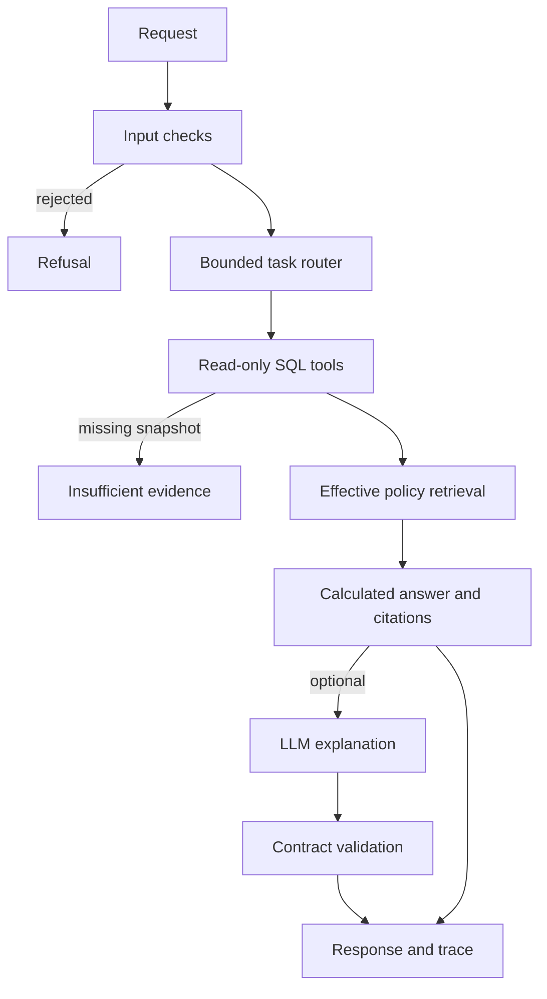

# BankOps Copilot

**Treasury analysis with traceable calculations, policy retrieval and a bounded AI workflow.**

Python · FastAPI · LangGraph · SQL · RAG · GigaChat · Streamlit · Docker · pytest

An independent portfolio project by **Jaber Mobarak**, inspired by public Sber AI engineering vacancies.
All banking data and policies are fictional. This is not a Sber product or an implementation of its internal architecture.

## What it does

An analyst asks **“What if outflows increase by 20%?”** The assistant reads a dated cashflow snapshot,
calculates the daily cash balance, retrieves the policy effective on that date, and identifies the first
liquidity-buffer breach. The interface exposes figures, policy excerpts and SQL templates for inspection.

- Cash balances and scheduled liquidity projection over 1–30 days.
- Outflow stress scenarios from 0–100%, calculated in integer kopecks.
- Counterparty concentration checks against a fictional policy limit.
- English/Russian policy retrieval with version and date filtering.
- Optional GigaChat or OpenAI-compatible LLM explanations.
- FastAPI responses, request IDs, minimal audit logs and Prometheus-format counters.
- Browser dashboard, liquidity chart, evidence tabs and JSON export.

## Run on Windows

1. Install **Python 3.12** from [python.org](https://www.python.org/downloads/).
2. Extract the project and open the `bankops-copilot` folder.
3. Double-click **`start_windows.bat`**. The first run downloads dependencies.
4. Open **http://localhost:8501**. Keep the terminal open while using the app.

Manual PowerShell setup:

```powershell
py -3.12 -m venv .venv
.venv\Scripts\python.exe -m pip install -r requirements.txt
.venv\Scripts\python.exe scripts\run.py
```

No API key, GPU, Docker or paid service is needed for the default mode. After dependencies are installed,
it works without network access. This mode uses calculated answers and retrieved excerpts; it does **not** run an LLM.

## Run on macOS / Linux

With Python 3.12 installed, run `bash start_unix.sh`, or:

```bash
python3.12 -m venv .venv
source .venv/bin/activate
python -m pip install -r requirements.txt
python scripts/run.py
```

Browser: http://localhost:8501 · API docs: http://localhost:8000/docs

## Try these questions

Keep snapshot date **2026-10-30** and horizon **7 days** for these reproducible examples.

| Question | Expected result |
| --- | --- |
| `Show liquidity` | Opening cash ₽26m; minimum scheduled cash ₽12m; no buffer breach |
| `What if outflows increase by 20%?` | Minimum cash ₽5.8m; first breach 2026-11-03 |
| `Show counterparty exposure` | Synthetic Alpha has 40%; fictional limit is 25% |
| `What is the liquidity buffer policy?` | Current policy excerpt with source ID `liquidity-v2` |
| `Покажи ликвидность` | Select `ru` for a Russian calculated answer |
| `Transfer 100 RUB to my account` | Refusal; no transaction tool runs |

The date and horizon controls are authoritative. Set them explicitly; the workflow does not infer arbitrary
time ranges from prose. Conflicting ISO dates and stress percentages are rejected. Ask one supported analysis
at a time; the API also accepts an explicit `task`. For a terminal demonstration, run `python scripts/demo.py`.

## Architecture



The router is rule-based. LangGraph coordinates a fixed workflow; an LLM never generates SQL or chooses
arbitrary executable tools. This demonstrates bounded agent engineering rather than autonomous planning
or a multi-agent system.

| Retrieval mode | Implementation | Requirements |
| --- | --- | --- |
| Default `lexical` | BM25 + character TF-IDF cosine, reciprocal-rank fusion | No model downloads |
| Optional `semantic` | BM25 + multilingual E5 dense embeddings in local Qdrant | Extra packages; first-run model download |

Default character vectors are lexical, not neural embeddings. Eight short policy files are manually
sectioned; no PDF parser or automatic chunker is claimed. Date filtering precedes ranking.

## Enable GigaChat

Install `python -m pip install -r requirements-gigachat.txt`, copy `.env.example` to `.env`, then set:

```dotenv
BANKOPS_PROVIDER=gigachat
GIGACHAT_CREDENTIALS=your_authorization_key
GIGACHAT_MODEL=GigaChat
GIGACHAT_SCOPE=GIGACHAT_API_PERS
```

Configure the official CA certificate bundle when required and restart the app. TLS verification stays
enabled. Follow [Sber's integration guide](https://developers.sber.ru/docs/ru/gigachain/tools/python/langchain-gigachat)
and [SDK/certificate instructions](https://developers.sber.ru/docs/ru/gigachat/guides/using-sdks).
Live GigaChat calls were not tested because credentials were unavailable.

The LLM adds a separate explanation. Output must parse as JSON, reference known source IDs and pass a
conservative numeral-token check. These checks do not prove semantic correctness. Provider errors or invalid
output preserve the deterministic answer and add a warning. Enabling an external provider sends the
question, calculated answer and retrieved excerpts to it. Do not commit `.env`.

## Local Qwen / OpenAI-compatible server

With a configured Ollama server and a downloaded model, set:

```dotenv
BANKOPS_PROVIDER=openai_compatible
LLM_BASE_URL=http://127.0.0.1:11434/v1
LLM_MODEL=qwen2.5:7b
```

The adapter can also target a vLLM/OpenAI-compatible server. The HTTP path was tested with mocks,
not a live model. Model availability and hardware needs depend on your setup. Docker users must set
a provider URL reachable from inside the API container.

## Dense retrieval

Install `python -m pip install -e '.[semantic]'`, set `BANKOPS_RETRIEVER=semantic` and restart.
The default model is `intfloat/multilingual-e5-small`. Passage/query prefixes and normalized vectors
are used. The Qdrant collection is rebuilt at startup, suitable for the small corpus.
Qdrant filtering is contract-tested with a fake encoder. Real neural embeddings and their quality
were not evaluated in the delivery environment.

## API example

```bash
curl -X POST http://localhost:8000/v1/ask \
  -H 'Content-Type: application/json' \
  -d '{"question":"What if outflows increase by 20%?","as_of":"2026-10-30","horizon_days":7}'
```

Set `BANKOPS_API_KEY` to protect `/v1/*` and `/metrics` using `X-API-Key`. Health and API schema remain
public. Defaults bind to loopback. This is shared-key access, not per-user identity or production RBAC.

## Verification

```bash
python -m pip install -r requirements-dev.txt
ruff check .
ruff format --check .
python -m pytest -q
python scripts/evaluate.py
```

Tests cover hand-calculated cases, cash conservation, stress monotonicity, rounding, snapshot isolation,
effective policies, read-only access, refusals, API auth/validation, provider fallback, Qdrant filtering
and actual Streamlit widgets against an HTTP API.

The [evaluation report](docs/evaluation_results.json) records **16/16 functional cases** and **16 authored
retrieval queries**. BM25 and hybrid lexical retrieval both achieved Hit@1 and Recall@3 of 1.0 on this tiny
fixture. This provides no evidence that hybrid retrieval outperforms BM25. It is not a held-out benchmark,
live LLM evaluation or real banking accuracy. GitHub Actions runs checks on pushes and pull requests.

## Docker

Run `docker compose up --build`. The image uses a non-root user; a named volume stores SQLite.
Docker execution was not verified because Docker was unavailable. The Python API and UI were executed directly.

## Data and limits

- Entirely synthetic fixture: 30 snapshots, 90 balances, 1,800 scheduled cashflow rows and 120 exposures.
- Snapshots: 2026-10-01 to 2026-10-30, each with a complete 30-day schedule. RUB only; no currency conversion.
- Monetary arithmetic uses integer kopecks. API/display `*_rub` fields are presentation values.
- “Forecast” rolls forward booked schedules; no ML forecasting model was trained.
- All thresholds are fictional, not actual Sber policies or regulatory requirements.
- Input checks are heuristics with false positives/negatives, not comprehensive PII or injection protection.
- No production tenant isolation, high availability, distributed rate limiter or compliance certification.
- No financial transactions, bank APIs, model training, LoRA, LLM-as-a-judge or inference optimization.

Regenerate data with `python scripts/generate_data.py`. Delete `runtime/treasury.sqlite` before restarting
to reseed; existing databases are not automatically overwritten.

## Repository guide

| Path | Purpose |
| --- | --- |
| `bankops/agent.py` | LangGraph state and bounded workflow |
| `bankops/tools.py` | SQL tools and calculations |
| `bankops/retrieval.py` | Temporal filtering, BM25, TF-IDF, optional E5/Qdrant |
| `bankops/providers.py` | GigaChat / compatible API and validation |
| `bankops/api.py` | API, authentication, concurrency bound, counters |
| `app.py` | Browser dashboard |
| `data/` | Synthetic CSVs, schema and fictional policies |
| `evaluation/` | Authored retrieval and functional fixtures |
| `tests/` | Automated checks |
| `docs/sber_requirements.md` | Researched vacancies and skill mapping |
| `docs/interview_guide.md` | Design decisions and demo walkthrough |
| `docs/github_publish.md` | Upload instructions and repository description |

Licensed under [MIT](LICENSE).
